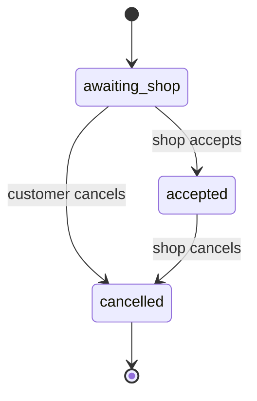
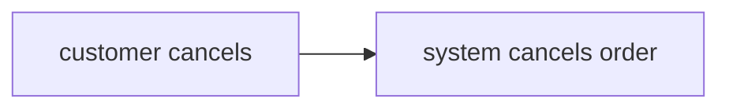

# When to draw mermaid in an issue file

One rule: **draw only when the picture says something the prose cannot.** A diagram that retells the paragraph beside it is a second place to keep in sync, and one day the two will disagree.

The default is **do not draw**. You need a reason to draw, not a reason to skip.

---

## Draw when one of these is true

| Condition | Diagram type |
| --- | --- |
| The behaviour has states that move between each other, with rules about which moves are legal | `stateDiagram-v2` |
| Three or more parties are involved and the order matters | `sequenceDiagram` |
| Several layers of branching conditions that need rereading as prose | `flowchart TD` |

Only these three. Anything else means you are drawing something that is not the behaviour of this piece of work.

## Never draw when

* The picture says the same thing as the text next to it
* It is a view of the whole system. That belongs in `ARCHITECTURE.md`, not an issue file
* It is a plan of how to do the work. That belongs to box 3 Planning
* It is a directory tree or a class diagram, which changes on every refactor

---

## What each file may hold

| File | Draw? |
| --- | --- |
| `issue.md` | Only a diagram the user pasted in. Never add one. This file is raw input |
| `intake.md` | **Never.** This file answers whether we take the work and why, which is reasoning, not behaviour |
| `restate.md` | Yes, under `## Agreed behaviour`, when the conditions above hold |

`intake.md` stays diagram-free because being able to draw the behaviour means you already know it in detail, and that detail belongs in `restate.md`, not in the decision.

---

## Rules for any diagram you do draw

1. Inside a fenced block tagged `mermaid`
2. **No more than 12 nodes.** More than that means this piece of work is too big to be one issue. Go back and check whether it should be split
3. Edge labels are real conditions, like `shop has not accepted yet`, never a bare `yes` and `no`
4. Every state in the picture also appears in the text. The picture expands on the words, it does not smuggle in new facts
5. If you change the text and the picture no longer matches, fix the picture in the same pass. Nothing checks this for you

## A diagram worth drawing

This earns its place because one sentence struggles to say it: **the customer can only cancel while the shop has not accepted**, and after that cancelling belongs to the shop.

## A diagram not worth drawing

This says exactly what the sentence "the customer cancels and the order is cancelled" says. Delete it.
